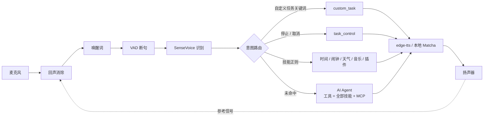

# PineconeAgent

运行在 **树莓派 5（8G）** 上的智能音箱，类似小爱音箱：

- **语音唤醒**：自定义中文唤醒词（默认“小派小派”），完全离线，无需训练
- **常用技能**：询问时间日期、设置 / 查询 / 取消闹钟（支持重复、贪睡、重启不丢）、播放本地音乐和网络电台、
  天气实况和预报（高德，需要在 `.env` 设置 `AMAP_KEY`）
- **自定义任务**：在 `tasks/` 放一个 YAML，“关键词 → shell / http / python / 播报”，不用写代码
- **对话打断**：播报过程中说唤醒词立即打断；回声消除生效时还可以开启 `audio.barge_in.vad`，直接开口打断
- **任务可终止**：“停止”“取消备份”“停止所有任务”“现在在做什么”，AI 也能调用
- **AI 对话**：LangChain v1 + LangGraph，OpenAI 兼容接口（DeepSeek / 通义 / Kimi / Ollama），
  流式按句播报，带短期记忆（会话 + 摘要压缩）和长期记忆（记住你的称呼和喜好），
  能通过工具调用全部技能和自定义任务，并可接入任意 MCP 服务

识别、唤醒、VAD、断网时的语音合成都在本地运行；只有 AI 对话、天气和在线语音合成（edge-tts）需要联网。

## 工作流程



所有“正在执行的事情”（技能、自定义任务、AI 推理、播报、音乐、闹钟响铃）都由
`TaskManager` 统一托管：唤醒打断只取消 **前台** 任务；音乐、备份这类 **后台** 任务
只有被点名取消或“停止所有任务”时才会停止。

## 硬件

### 必备

| 项目 | 推荐 | 说明 |
| --- | --- | --- |
| 主机 | 树莓派 5（8G） | 4G 也能跑；系统用 Raspberry Pi OS Bookworm 64 位 |
| 电源 | 官方 27W USB-C 电源（5V 5A） | 普通手机充电器供电不足时会降频，USB 外设也可能掉线 |
| 散热 | 官方 Active Cooler 或带风扇的外壳 | 语音识别持续占用 CPU，被动散热容易过热降频 |
| 存储 | 32G 以上 A2 级 microSD，或 M.2 HAT+ 接 NVMe 固态 | 对话历史和闹钟存在 SQLite 中，固态更耐写 |

### 音频方案（按预算选一种）

树莓派 5 **没有 3.5mm 音频口**，麦克风和扬声器都要通过 USB（或 HDMI、蓝牙）接入。
请选 **免驱（USB Audio Class）** 的设备，插上即用。

| 方案 | 设备 | `audio.aec.mode` | 效果 |
| --- | --- | --- | --- |
| 零预算起步 | 手头的 USB 麦克风或带麦 USB 耳机，加现有音箱或 HDMI 显示器 | `software` 或 `none` | 能用；近距离唤醒，播报时用唤醒词打断 |
| 入门推荐 | USB 全向会议麦克风，加 USB 免驱声卡（CM108 / CM119 芯片）和有源小音箱 | `software`，播放音乐多时用 `pipewire` | 性价比最高；麦克风和扬声器尽量隔开 20cm 以上 |
| 一体最省心 | USB 会议全向麦（扬声器、麦克风和硬件回声消除做在一起，如 Jabra Speak 410 / 510） | `hardware` | 回声消除好，可以直接开口打断；二手很便宜 |
| 远场拾音 | ReSpeaker USB Mic Array v2.0（4 麦阵列，带硬件回声消除） | `hardware` | 3～5 米也能唤醒；**扬声器必须接在阵列自带的 3.5mm 输出上**，否则阵列拿不到播放信号，回声消除不生效 |

选购注意：

- **不建议使用蓝牙音箱**。蓝牙有 100～300ms 的延迟且不稳定，软件回声消除很难对齐，打断效果差。
- **不建议使用需要编译驱动的 HAT 声卡**（如 ReSpeaker 2-Mics Pi HAT）。它们在树莓派 5 新内核上经常装不上驱动；USB 设备最稳。
- 麦克风选 **全向**，不要选指向性的直播麦，否则只有正对着说话才能唤醒。
- 扬声器不要正对麦克风，音量也不要开得过大，这对任何回声消除方案都有帮助。

回声消除（AEC）是配置项，初期不买任何额外硬件也能用：

| `audio.aec.mode` | 说明 |
| --- | --- |
| `none` | 不做回声消除，只能用唤醒词打断（播报期间自动提高唤醒阈值防误唤醒） |
| `software`（默认） | 进程内 WebRTC APM（livekit），没有时退回 speexdsp；能消除播报的回声，不能消除 mpv 音乐的回声 |
| `pipewire` | 系统级 `module-echo-cancel`，能消除包括音乐在内的所有声音；`install_pi.sh --pipewire-aec` 一键配置 |
| `hardware` | 麦克风阵列自带 AEC，程序内跳过处理 |

## 在树莓派上安装

```bash
git clone <仓库地址> ~/PineconeAgent && cd ~/PineconeAgent

# 一键安装：系统依赖、Python 环境、语音模型、开机自启服务
bash scripts/install_pi.sh
# 国内网络加速：GH_PROXY=https://ghfast.top/ bash scripts/install_pi.sh
# 需要消除音乐回声：bash scripts/install_pi.sh --pipewire-aec

# 填入大模型密钥（可选，不填只使用本地技能）
nano .env
systemctl --user restart pinecone

# 查看日志
journalctl --user -u pinecone -f
```

音频设备不是系统默认时，先列出设备，再在 `config/config.local.yaml` 中按名称关键字指定：

```bash
.venv/bin/python -m pinecone.audio.devices
```

```yaml
audio:
  input_device: "USB"        # 设备名包含的关键字
  output_device: "USB Audio"
```

## 开发环境（Mac / Linux 电脑）

```bash
uv sync --extra dev --extra aec --extra tui   # 安装依赖（tui：文本模式的全屏界面）
bash scripts/download_models.sh        # 下载语音模型
uv run pytest                          # 运行测试
uv run ruff check . && uv run ruff format .

# 文本模式：终端输入代替说话，回复仍从扬声器播报，适合调试技能和 AI
OPENAI_API_KEY=sk-xxx uv run python -m pinecone.main --text
# 文本模式不用全屏界面，逐行读标准输入（也可以用管道喂指令）
uv run python -m pinecone.main --text --plain
# 语音模式
uv run python -m pinecone.main --debug
```

音乐技能需要 libmpv：macOS `brew install mpv`，树莓派由安装脚本处理。

文本模式默认是全屏界面：上面是对话区（你说的话、音箱念的话、候选列表），中间是日志区，
底部是状态栏（当前状态、追问倒计时、正在运行的任务）和输入框，日志不会再插进正在输入的那一行。
思考或播报中接着输入会像语音一样打断。没装 `tui` 依赖或输入不是终端时自动退回逐行输入。

| 按键 | 作用 |
| --- | --- |
| ↑ / ↓ | 翻之前说过的话（保存在 `data/tui_history.txt`） |
| Esc | 打断正在思考或播报的这一轮，后台任务不受影响 |
| F2 | 隐藏 / 显示日志区 |
| F3 | 只看警告和错误 / 恢复全部 |
| Ctrl+L | 清空对话区和日志区 |
| Ctrl+C | 退出（也可以输入 `exit`） |

## 配置

- `config/config.yaml`：全部配置项，每一项都有中文注释和默认值；
- `config/config.local.yaml`：本机覆盖（设备名、密钥等），不提交到 git；
- 字符串中可以用 `${环境变量}` 或 `${环境变量:默认值}`，密钥建议放在 `.env` 中。

常用配置：

```yaml
wake:
  keywords: ["小派小派"]      # 唤醒词，任意中文，可以配置多个
  threshold: 0.25             # 越小越灵敏
tts:
  edge_voice: zh-CN-XiaoxiaoNeural
agent:
  base_url: https://api.deepseek.com/v1
  api_key: ${OPENAI_API_KEY:}
  model: deepseek-chat
  persona: "说话简短，偶尔幽默"
skills:
  disabled: [music]           # 禁用某个技能
  settings:
    music: {library: [~/Music]}
```

## 语音指令示例

| 功能 | 说法 |
| --- | --- |
| 时间 | “现在几点”“今天几号”“明天星期几” |
| 闹钟 | “明天早上7点叫我起床”“10分钟后提醒我关火”“每个工作日7点半的闹钟”“我有哪些闹钟”“取消明天7点的闹钟”“再睡五分钟” |
| 天气 | “今天天气怎么样”“北京明天天气”“后天会下雨吗”“周末杭州天气”“未来几天天气”“现在外面多少度” |
| 音乐 | “播放周杰伦的歌”“我想听晴天”“来首歌”“暂停”“下一首”“大声点”“这是什么歌”“停止播放” |
| 任务控制 | “停止”“别说了”“取消备份照片”“停止所有任务”“现在在做什么” |
| 自定义任务 | “打开客厅的灯”“开始备份”“你的IP是多少”（见 `tasks/`） |
| AI | 其他任何问题；“记住我喜欢听周杰伦”“我叫什么”“屋里太暗了”（AI 会调用开灯任务） |

## 扩展

### 自定义任务（不写代码）

在 `tasks/` 下新建 YAML，重启生效。完整字段见 [tasks/README.md](tasks/README.md)：

```yaml
name: 开灯
keywords: ["开灯"]
patterns: ["打开(?P<room>客厅|卧室)的?灯"]   # 命名分组可在动作中用 {{room}} 引用
background: false       # true：后台执行，不阻塞对话
timeout: 15             # 超时自动取消
actions:
  - type: http
    method: POST
    url: "${HA_URL}/api/services/light/turn_on"
    headers: {Authorization: "Bearer ${HA_TOKEN}"}
    json: {entity_id: "light.living_room"}
  - type: speak
    text: "好的，{{room}}灯已打开"
on_cancel:
  - type: speak
    text: "开灯已取消"
```

动作类型：`shell`（取消时终止整个进程组）、`http`、`python`（可注入取消令牌）、`speak`、`sleep`；
新增动作类型见 `pinecone/tasks/actions/`。

### 技能插件（写 Python）

```bash
cp -r pinecone/skills/_template plugins/hello
```

```python
@register_skill
class HelloSkill(Skill):
    name = "hello"
    description = "打招呼"
    patterns = {"greet": [r"你好(?P<who>.*)"]}  # 命名分组成为 intent.slots

    async def handle(self, ctx: SkillContext, intent: Intent) -> SkillResult:
        return SkillResult(reply=f"你好{intent.slot('who', '')}")

    def tools(self) -> list[ToolSpec]:  # 可选：同时作为 AI 工具
        return [ToolSpec(name="say_hello", description="打招呼", intent="greet")]
```

技能只依赖 `SkillContext`：`ctx.say()` 播报、`ctx.spawn()` 启动可被取消的后台任务、
`ctx.settings` 私有配置、`ctx.data_dir` 数据目录、`ctx.on_state_change()` 订阅状态。
详见 [pinecone/skills/_template/README.md](pinecone/skills/_template/README.md)。

### MCP 服务

```yaml
agent:
  mcp_servers:
    weather:
      transport: stdio
      command: uvx
      args: [mcp-weather-server]
```

启动时自动加载，工具名为 `服务名_工具名`；某个服务连不上只会告警，不影响其他功能。

## 目录结构

```
config/        配置文件（config.yaml + 本机覆盖 config.local.yaml）
tasks/         自定义任务，一个任务一个 YAML
plugins/       用户技能插件（复制 pinecone/skills/_template）
models/        语音模型（scripts/download_models.sh 下载，不提交）
data/          运行数据：闹钟、对话历史、长期记忆（SQLite，不提交）
scripts/       install_pi.sh 安装脚本、download_models.sh 模型下载
deploy/        systemd 服务、PipeWire 回声消除配置
pinecone/
  main.py app.py         入口与组装
  dialog.py              对话流程（状态机驱动：唤醒 → 聆听 → 思考 → 播报 → 追问）
  core/                  配置、事件总线、状态机、任务托管（TaskManager / CancelToken）
  audio/                 麦克风、扬声器、设备选择、回声消除（aec/）
  speech/                唤醒词（wake/）、VAD（vad/）、识别（asr/）、合成（tts/）
  nlu/                   文本归一化、中文时间解析、意图路由
  skills/                技能框架 + 内置技能（builtin/）+ 模板（_template/）
  tasks/                 自定义任务引擎（加载、动作注册表、执行器）
  agent/                 AI Agent：模型、提示词、记忆（memory/）、工具（tools/）
  tui/                   文本模式的全屏界面（Textual）：对话区、日志区、状态栏、输入框
tests/         单元测试（pytest，假模型 / 假声卡，不需要硬件和网络）
```

## 常见问题

- **唤醒不灵敏 / 误唤醒**：调整 `wake.threshold`（越小越灵敏）和 `wake.score`；唤醒词建议 4 个字。
- **播放音乐时很难唤醒**：软件 AEC 拿不到 mpv 的声音，可改用 `--pipewire-aec`，或调低音乐音量。
- **断网**：识别、唤醒、技能、自定义任务照常工作；播报自动降级到本地 Matcha 合成；AI 会提示连不上。
- **任务停不下来**：shell 动作取消时会对整个进程组 SIGTERM，3 秒后 SIGKILL；
  python 动作中的同步函数需要检查 `token.cancelled`。
